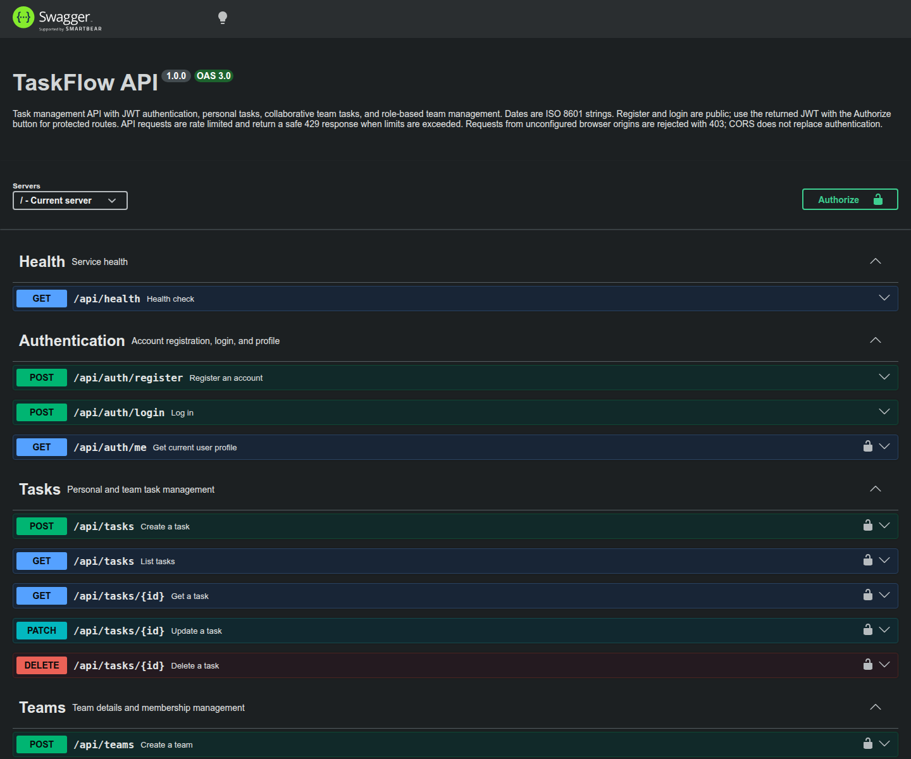

# TaskFlow API

[](https://github.com/sikwaemu-ui/Task-Management-API-/actions/workflows/ci.yml)

A production-hardened REST API for personal task tracking and collaborative team task management. Built with Express 5, TypeScript, Prisma 7, and PostgreSQL, with JWT authentication, team-scoped permissions, request validation, and interactive Swagger documentation.

**Repository:** [sikwaemu-ui/Task-Management-API-](https://github.com/sikwaemu-ui/Task-Management-API-) · **API docs:** `/api-docs` · **Health:** `/api/health`

> Hosting uses Render for the API and Neon for PostgreSQL. The exact public service URL and current production health could not be verified from the repository or public deployment records; see [Deployment](readme/DEPLOYMENT.md) for the evidence and operator checks.

## Project scope

- Account registration, login, profile lookup, bcrypt password hashing, and signed JWT bearer authentication.
- Personal task CRUD plus collaborative team tasks with status, priority, due date, filtering, case-insensitive search, sorting, and pagination.
- Team creation, member management, role-aware permissions, and protection against unauthorized team/task access.
- Prisma data model and versioned PostgreSQL migrations for users, tasks, teams, and team memberships.
- OpenAPI 3.0.3 contract and Swagger UI for exploring and trying the API.

## Engineering and security

- Layered TypeScript structure: routes and controllers handle HTTP, services hold business rules and Prisma operations, and Zod schemas validate input.
- Helmet headers, disabled `X-Powered-By`, exact-origin configurable CORS, and request logs that omit query strings, bodies, and headers.
- Configurable in-memory rate limits for authentication and the API; the health endpoint stays available under general API limits.
- Startup validation for database/JWT configuration, production-safe error responses, and bounded graceful shutdown of HTTP and Prisma/PostgreSQL resources.
- Team membership and ownership checks are enforced in services; protected team resources return not-found responses to reduce enumeration.
- See [SECURITY.md](SECURITY.md) for configuration and operational security details.

## API at a glance

| Area | Endpoints |
| --- | --- |
| Health | `GET /api/health` |
| Authentication | `POST /api/auth/register`, `POST /api/auth/login`, `GET /api/auth/me` |
| Tasks | `POST /api/tasks`, `GET /api/tasks`, `GET/PATCH/DELETE /api/tasks/{id}` |
| Teams | `POST/GET /api/teams`, `GET/PATCH /api/teams/{id}` |
| Team membership | `POST /api/teams/{id}/members`, `DELETE /api/teams/{id}/members/{userId}` |

Protected routes use `Authorization: Bearer <JWT>`. Team OWNER/ADMIN memberships manage teams and memberships. Team task access is membership-scoped; a creator can manage their own task, and OWNER/ADMIN can manage team tasks created by others. The full contract and payload schemas are in Swagger UI.

## Technology

| Concern | Technology |
| --- | --- |
| Runtime and API | Node.js, TypeScript, Express 5 |
| Data and migrations | PostgreSQL, Prisma 7, `pg`, Prisma PostgreSQL adapter |
| Authentication and validation | JWT, bcryptjs, Zod |
| API documentation | OpenAPI 3.0.3, Swagger UI |
| Production controls | Helmet, CORS, express-rate-limit, structured request logging, graceful shutdown |
| CI | GitHub Actions, Node.js 22, PostgreSQL 16 service |
| Hosting | Render API service and Neon PostgreSQL (provider settings live outside this repository) |

## Run locally

Requirements: Node.js 22 (the CI-tested runtime), npm, and PostgreSQL. The repository does not currently declare a `package.json` `engines` range.

```bash
npm ci
cp .env.example .env
# Set DATABASE_URL and a random JWT_SECRET (at least 32 non-whitespace characters)
npx prisma generate
npx prisma migrate dev
npm run dev
```

The API defaults to `http://localhost:5000`. Open `http://localhost:5000/api-docs`; health is at `http://localhost:5000/api/health`. Use `PORT=5001 npm run dev` to select another port. See [local setup](readme/RUNNING-LOCALLY.md) for the full configuration reference.

## Tests and build

```bash
npm test
npm run build
```

The test suite uses Node's test runner and covers auth, tasks, teams, team tasks, OpenAPI, and security. CI runs the same test and build scripts against a temporary PostgreSQL 16 service.

## Continuous integration status

The [CI workflow](.github/workflows/ci.yml) runs on pushes and pull requests. It installs with `npm ci`, uses Node.js 22, generates and validates Prisma, applies checked-in migrations to a disposable PostgreSQL 16 database, runs the tests, and builds the TypeScript app.

**Latest verified run:** [CI run #5](https://github.com/sikwaemu-ui/Task-Management-API-/actions/runs/38701853855) completed successfully on October 15, 2026, for `main` at `e8808ee`. The individual job shows successful dependency installation, Prisma generation and validation, test-database migrations, tests, and production build. This is a CI result; it does not verify a Render deployment or production health.

## Deployment status and architecture

The API is hosted on Render and uses Neon PostgreSQL. The app reads the database URL from `DATABASE_URL`; its PostgreSQL adapter enables SSL when the connection string specifies `sslmode=require` or the host is a Neon domain. Credentials belong in Render environment settings and must never be committed.

The repository contains no Render manifest, production URL, provider logs, GitHub deployment records, or documented Render pre-deploy migration command. Therefore the Render service URL, connected GitHub branch/auto-deploy setting, effective build/runtime configuration, migration execution in production, and current health remain **unverified**. GitHub Actions CI does not deploy to Render. See [deployment operations and verification](readme/DEPLOYMENT.md) for commands, secret names, migration guidance, and the evidence gaps.

## Documentation

- [Project overview and architecture](readme/PROJECT-OVERVIEW.md)
- [Local setup and commands](readme/RUNNING-LOCALLY.md)
- [Endpoint and authorization guide](readme/API-GUIDE.md)
- [CI and maintenance](readme/CI-AND-MAINTENANCE.md)
- [Render + Neon deployment guide](readme/DEPLOYMENT.md)
- [CV-ready summary](readme/CV-SUMMARY.md)
- [Swagger UI screenshot](readme/screenshots/taskflow-api-docs.png)


